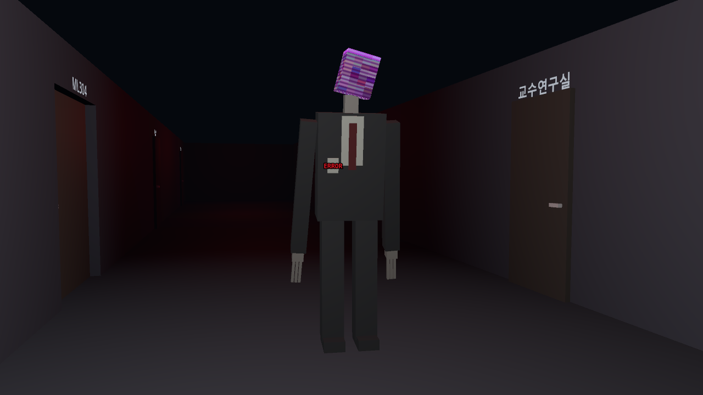
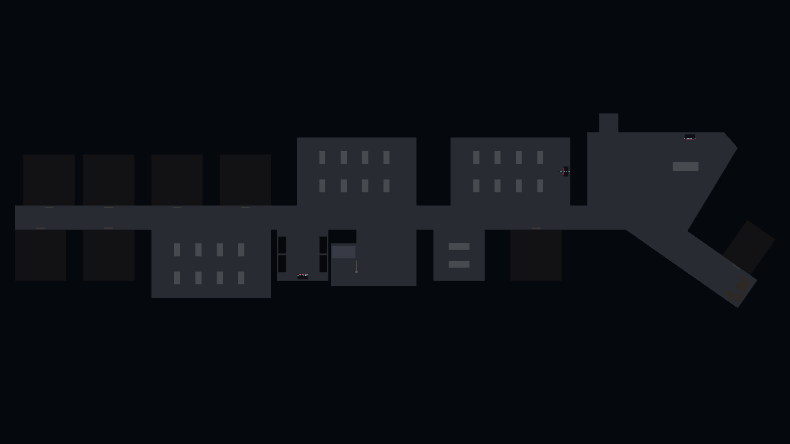

# 미디어랩스: 데이터 노이즈 — 초단기 공포 탈출 게임

오픈소스SW 6조 팀 프로젝트. 팀 기획안 「초단기 공포 탈출 게임 기획안 리포트」를 바탕으로 한 Godot 4 프로젝트. 현재 **그레이박스 프로토타입** 상태다.
회색 상자 복도, 빨간 캡슐 괴물, 글자만 있는 터미널로 "정제 중 괴물이 다가오고 빛으로 멈추는" 루프가 재미있는지 먼저 확인하는 것이 목적이다.

## 실행

1. [Godot 4.3 이상](https://godotengine.org/download) 다운로드 (설치 불필요, 실행 파일 하나).
   Windows라면 터미널에서 `winget install --id GodotEngine.GodotEngine` 으로도 받을 수 있다.
2. Godot 실행 → **Import** → 이 폴더의 `project.godot` 선택 → **Edit**.
3. 에디터에서 **F5** (Run Project).
   - 그래픽이 깨지거나 느리면 에디터 상단 우측 **Forward+ → Compatibility** 로 바꾼다.
   - 한글이 네모로 보이면 Project Settings → GUI → Theme → Custom Font 에 Noto Sans KR 같은 한글 폰트를 넣는다.

Godot 4.7.2 에서 import·실행·스모크 테스트 통과 확인됨 (2026-11-24, 3층 평면 맵).

## 자동 스모크 테스트

손으로 플레이하지 않고 전체 루프를 검사한다. 파트를 고친 뒤 합치기 전에 돌려 볼 것.

```
godot --path . res://scenes/smoke_test.tscn
```

창이 잠깐 떴다가 닫히고 콘솔에 항목별 `[OK]` / `[FAIL]` 이 찍힌다. 종료 코드 0이면 통과.
검사 항목: 계단실 시작 → 로비 문 열기 → 방 문 여닫기·잠긴 문·괴물이 문 밀어 열기 → 터미널 3개 정제(오답 처리 포함) → 문 3개 순서대로 개방 → 괴물 활성화 → 괴물이 좁은 문을 지나 모든 구역으로 길찾기 가능 → 손전등 비추면 FROZEN → 끄면 CHASE로 이동 → 접촉 사망 → 체크포인트 리스폰 → 탈출 승리.
(에디터에서는 `scenes/smoke_test.tscn` 을 열고 **F6** 으로 현재 씬 실행.)

## 조작

| 키 | 동작 |
|---|---|
| W A S D / 방향키 | 이동 |
| Shift | 달리기 (발소리 소음 증가) |
| 마우스 | 시선 (눈높이 1.2m, 몸 반지름 0.3m) |
| F | 손전등 켜기/끄기 (배터리 소모·회복) |
| E | 문 열기·닫기 / 터미널 정제 시작 |
| 0 / 1 | 미니게임 입력 |
| ESC | 미니게임 중단 / 마우스 해제 |
| R | 탈출 후 다시 시작 |

## 게임 흐름 (기획안 6p를 미디어랩스 3층 구조에 맞춤)

```
계단실 시작 ─ E로 로비 문 열기 ─▶ 3층 로비
  01 도입  서쪽 구역(교수연구실·ML304·ML313·서버실)은 처음부터 열려 있음
           서버실 노드1 정제 ─▶ 방화셔터1 열림, 괴물 활성화
  02 위기  셔터1 동쪽: ML314 강의실 노드2 정제 ─▶ 방화셔터2 열림
  03 절정  홀·학회실: 학회실 노드3 정제 ─▶ 홀 엘리베이터(메인 게이트) 열림 ─▶ 탈출
```

## 기획안 미정 항목에 대해 뼈대가 임시로 정한 규칙

기획안 9p의 세 질문에 대한 **제안**이다. 플레이테스트 후 숫자와 규칙을 바꿔도 된다. 모두 `@export` 변수라 에디터 Inspector에서 바로 조정 가능.

| 질문 | 뼈대의 규칙 | 어디서 바꾸나 |
|---|---|---|
| 실패·재시도 | 괴물 접촉 = 즉사. 2초 뒤 **마지막으로 정제한 지점**에서 재시작. 정제한 노드는 유지. 괴물은 스폰 위치로 돌아감 | `game_manager.gd` RESPAWN_DELAY, `purify_node()` |
| 괴물 접촉 결과 | 체력·자원·탄약 없음. 1회 접촉 즉사 | `monster.gd` kill_distance |
| 손전등 제약 | 켜두면 25초 분량 배터리 소모, 끄면 초당 0.6 회복. **터미널 조작 중엔 손전등을 켤 수 없음** | `player.gd` battery_* |
| 미니게임 오답 | 오답 = 큰 소음(1.0) + 처음부터 다시. 즉사는 아님. 20초 초과 = 실패 + 큰 소음. 터미널은 남아서 재시도 가능 | `minigame.gd` time_limit, mistake_noise |

## 팀 분담과 파일

| 담당 | 역할 | 파일 |
|---|---|---|
| **A 플레이어** | 이동, 손전등 배터리, 상호작용, 발소리 | `scripts/player.gd`, `scenes/player.tscn` |
| **B 괴물 AI** | 상태기계, 소음 청취, 빛 반응, 길찾기, 괴물 모습 | `scripts/monster.gd`, `scripts/monster_model.gd`, `scenes/monster.tscn` |
| **C 미니게임·UI** | 0/1 순서 입력, 패턴 대조, HUD | `scripts/minigame.gd`, `scripts/terminal.gd`, `scripts/hud.gd` |
| **D 레벨·연출** | 3층 레벨, 문·셔터, 조명, 노이즈 셰이더, 사운드 | `scripts/level_builder.gd`, `scripts/door.gd`, `scripts/start_door.gd`, `scripts/room_door.gd`, `scripts/noise_overlay.gd`, `shaders/` |

**서로의 파일을 직접 고치지 않는다.** 파트 간 접점은 아래 이벤트만 쓴다.

## 이벤트 규약 (`scripts/game_manager.gd`, 자동로드 `GameManager`)

| 시그널 | 인자 | 누가 쏘나 | 누가 받나 |
|---|---|---|---|
| `noise_emitted` | position: Vector3, loudness: 0.0~1.0 | A(발소리 0.2 / 달리기 0.45), C(터미널 기동 0.6, 키 0.3, 오답 1.0) | B(접근 판단), D(화면 노이즈 튐) |
| `node_purified` | node_index, purified_count | C(터미널) | D(문 개방, 노이즈 감소), B(활성화), HUD |
| `minigame_started` / `minigame_finished` | terminal, (success) | C | A(입력 잠금/해제) |
| `player_died` / `player_respawned` | (checkpoint) | B → GameManager | A, B, C, HUD |
| `game_won` | — | D(탈출 트리거) | 전체 |

호출 함수: `GameManager.emit_noise(pos, loudness)`, `GameManager.start_minigame(terminal)`, `GameManager.finish_minigame(terminal, ok)`, `GameManager.purify_node(i)`, `GameManager.kill_player()`, `GameManager.win()`.

괴물의 빛 판정은 `player.is_lighting(world_pos)` 한 함수만 쓴다 (켜짐 + 사거리 + 원뿔 각도 + 벽 가림 체크).

## 괴물 상태기계 (`monster.gd`)

```
DORMANT ──노드1 정제──▶ IDLE ──소음 들림──▶ INVESTIGATE ──플레이어 발견/큰 소음──▶ CHASE
   ▲                      ▲                      │                                  │
   └──(리스폰 시 노드 0개)─┘◀───도착, 못 찾음─────┴──────────4초간 놓침──────────────┘
                                   어느 상태든 손전등에 비춰지면 ▶ FROZEN ──빛 꺼짐──▶ CHASE (빠르게)
```
오른쪽 위 HUD에 현재 상태가 글자로 뜬다(디버그).

**모습: 글리치 교수** (`monster_model.gd`, `shaders/glitch_face.gdshader`). 정장 차림의 마른 사람 실루엣으로, 팔이 지나치게 길고 고개가 꺾여 있다. 얼굴 자리는 깨진 화면 노이즈다. 특정 인물을 본뜨지 않은 원본 디자인이고, 기본 도형만으로 코드에서 만든다(외부 에셋 없음).
얼굴 노이즈 색이 상태를 나타낸다: 보라 IDLE, 주황 INVESTIGATE, 빨강 CHASE(팔을 앞으로 뻗음), 하늘색 FROZEN(그 자세로 굳고 더 심하게 찢어짐).



## 레벨 (`level_builder.gd`)

지금은 코드가 상자를 쌓아 만든다(그레이박스). 네비메시도 실행 시 베이크된다.
스크립트가 `@tool` 이라 **에디터에서 `scenes/main.tscn` 을 열면 맵이 3D 뷰에 그대로 보인다.** 위에서 내려다보려면 3D 뷰에서 키패드 **7** (또는 뷰포트 좌상단 "원근" 메뉴 → 상단 뷰), 마우스 휠로 줌, 휠 클릭 드래그로 이동. `ROOMS` 등 숫자를 고쳐 저장하면 뷰가 다시 그려진다.

**평면**은 미디어랩스 3층 손그림([`reference/measurements/3층_평면도_스케치.webp`](reference/measurements/3층_평면도_스케치.webp))을 따른다.
**치수**: 천장 2.7m는 Polycam 스캔 실측값. 복도 안쪽 폭은 실측 2.5m의 2배인 **5m** (플레이 공간 확보) ([`medialabs_scan_2026-11-24.md`](reference/measurements/medialabs_scan_2026-11-24.md)).
방 크기는 강의실(ML) 14 x 8m > 학회실 약 60m² > 교수연구실·회의실·랩실·서버실 6 x 6m.



```
 위쪽(z-):  교수 교수  교수 교수   [ML313]      [ML314]    엘베  [  학회실  ]
            ───────────────────────────────────────────────┐홀 기둥  ╲
 복도 →     서쪽 끝                          셔터1        셔터2      ╲ 사선 복도 ─ 랩실
            ───────────────────────────────────────────────┘          ╲
 아래쪽(z+): 회의 랩  [ML304]  서버 계단|로비|  랩    랩                 잔해(출입 금지)
                               T1   ▲P  엘베
 T1 서버실(33.7, 8.15)   T2 ML314 교탁(64.5, -6.65)   T3 학회실(79, -10.75)
 P 계단실 시작(38.6, 7.0), +x(로비 문)를 보고 시작   괴물 스폰(57, 0): 셔터1과 셔터2 사이
 들어갈 수 있는 방: ML304, ML313, ML314, 서버실, 셔터1 옆 랩실, 학회실. 나머지는 잠긴 문.
```

**방 문** (`room_door.gd`): 모든 방에 문이 있다. 들어갈 수 있는 방 9개 문은 E로 여닫고(소음 0.25), 잠긴 방 8개 문은 E를 누르면 덜컹거린다(소음 0.35).
괴물은 닫힌 문 앞에 오면 문을 거칠게 밀어 연다(소음 0.8). 문은 플레이어와 빛·시야는 막지만 괴물 몸은 막지 않는다(충돌 레이어 3).

실제 스캔은 Godot 에디터에서 `reference/scan_viewer.tscn` 으로 볼 수 있다. 스캔 원본(GLB)은 용량과 공개 저장소 문제로 Git에 올리지 않으니 팀 단톡방에서 받아 `reference/scans/` 에 넣는다.
실제 레벨로 바꿀 때: `Main` 노드의 스크립트를 떼고, `NavRegion` 아래에 모델링된 레벨을 넣고 에디터에서 Bake. **문은 `Doors` 아래에** 두어야 네비메시에서 제외된다 (안 그러면 닫힌 문 자리를 괴물이 영원히 못 지나간다).
## 일정

**발표·시연: 2026-12-10.** 할 일은 전부 [GitHub Issues](https://github.com/jhyeun1020/opensource-team6-datanoise/issues)에 있다. 각자 하나씩 Assignee로 잡고 PR로 올린다 (방법은 `CONTRIBUTING.md`).

## 범위 규칙

괴물 1종, 미니게임 2종, 엔딩 1개. 이 셋을 넘기지 않는다.

## 사용한 오픈소스

| 이름 | 용도 | 라이선스 | 링크 |
|---|---|---|---|
| Godot Engine 4.7 | 게임 엔진 (렌더링, 물리, 네비게이션, UI, 셰이더) | MIT | https://godotengine.org |
| GDScript | 게임 로직 스크립트 언어 (Godot 내장) | MIT | https://docs.godotengine.org |

에셋을 추가하면 여기에 이름·출처·라이선스를 반드시 적는다. 후보: Kenney (CC0, kenney.nl), freesound (CC0 필터), Poly Haven (CC0).

## 라이선스

이 프로젝트의 코드는 MIT 라이선스로 공개한다. 기획안·레퍼런스 사진 등 `docs/`, `reference/` 의 자료는 팀 내부용이다.
